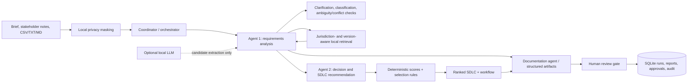

# Software Requirements Specification

## FinSpec AI — Financial Requirements and SDLC Decision Support

**Version:** 1.0 · **Prototype scope:** Indian digital loan origination · **Date:** 23 November 2026

## 1. Purpose and problem

Financial software requirements arrive through stakeholder discussions, policy documents, legacy-system notes, control requirements, and customer needs. Manual synthesis can leave gaps, contradictions, ambiguous acceptance criteria, weak traceability, and late security/compliance review. FinSpec AI analyzes a project brief and supporting material, creates reviewable requirement candidates, retrieves relevant source evidence, evaluates quality, and recommends a project-specific software development life cycle (SDLC) with validation gates.

The prototype uses digital personal-loan origination at an Indian regulated bank as its demonstration case. It is an advisory requirements-engineering assistant. It does not make loan decisions, interpret law conclusively, approve production releases, or replace qualified compliance, privacy, security, or legal review.

## 2. Objectives

1. Accept structured project characteristics and unstructured stakeholder text.
2. Extract traceable functional/nonfunctional requirement candidates with acceptance criteria, priority, risk and confidence.
3. Detect vague terms, missing context, likely contradictions and duplicate candidates; ask follow-up questions.
4. Retrieve jurisdiction- and version-labelled source evidence and retain citations.
5. Recommend and rank Agile, DevSecOps, Spiral, V-Model, Waterfall and hybrid SDLC options using explicit rules and MCDA.
6. Generate a project SRS, stories, use cases, acceptance criteria, compliance mappings, risk register, traceability, open issues, reports and a tailored workflow.
7. Require human approval and keep a persistent run/review audit trail.
8. Compare structured extraction with a simple baseline on a synthetic case, with limitations made visible.

## 3. Scope and users

**In scope:** local single-user prototype; project brief and stakeholder text input; CSV, TXT and Markdown import; masked storage of common direct identifiers; deterministic analysis; local keyword-based evidence retrieval; optional local-model suggestion extraction; SDLC ranking; report export; human approve/change-request; SQLite persistence.

**Out of scope:** live lending decisions, customer eligibility or credit scoring, live bank/KYC/bureau integrations, legally authoritative compliance determinations, production identity/access management, multi-user collaboration, document OCR, vector embeddings, automated deployment, and unreviewed production release.

Primary users are product owners/business analysts, loan operations, software architects, information-security and privacy teams, compliance/legal reviewers, QA, operations and internal audit.

## 4. Architecture and sequence

Agent 1 extracts and validates; Agent 2 evaluates project factors and ranks delivery models; a documentation stage renders artifacts from their structured outputs. Evidence and text are treated as untrusted input. Optional LLM-generated requirements remain low-confidence suggestions and cannot override deterministic controls or scores.

## 5. Functional requirements

| ID | Requirement |
|---|---|
| FR-01 | Load a synthetic digital-loan project and allow editable project name, jurisdiction, institution, description, stakeholders, constraints and project factors. |
| FR-02 | Accept CSV requirement data and TXT/MD project/policy notes; the supported file types shall be clear in the UI. |
| FR-03 | Redact common identifiers (email, phone, Indian PAN/Aadhaar-shaped values, and payment-card-like digit strings) before persistence or optional local-model use. |
| FR-04 | Extract and classify requirement candidates across functional, business, security, privacy, compliance, performance, availability, auditability, data, integration, operations and testing dimensions. |
| FR-05 | Attach ID, statement, category, source/excerpt, business rationale, priority, dependencies/assumptions, acceptance criteria, evidence mapping, risk, confidence and approval state. |
| FR-06 | Detect configured ambiguity terms, conflict patterns and duplicate candidates; provide adaptive clarification questions for missing delivery and control context. |
| FR-07 | Retrieve relevant sources with jurisdiction, version/date, source ID, URL, matched terms and a short supporting summary. |
| FR-08 | Generate a ranked SDLC recommendation from stability, change frequency, criticality, security/technical risk, complexity, legacy dependence, delivery automation, stakeholder access, verification, consequence and schedule pressure. |
| FR-09 | Display factor scores, model rankings, explanations, confidence, rules and human approval requirement. |
| FR-10 | Generate a project-specific workflow with phases, activities, roles, deliverables, security controls and entry/exit gates. |
| FR-11 | Generate the ten common reports and engineering artifacts listed in Section 7. |
| FR-12 | Allow individual report downloads and full JSON bundle export. |
| FR-13 | Provide role-labelled human approve/change-request actions with reviewer comments; persist review state and timestamps. Prototype role labels do not authenticate identity. |
| FR-14 | Persist brief, analysis, SDLC scores, workflow, reports and ordered audit events in local SQLite and expose recent run history. |
| FR-15 | Report synthetic evaluation metrics versus a naive shall/must sentence-extraction baseline, with clear proxy and validity limitations. |
| FR-16 | If `FINSPEC_LLM_URL` is configured, an OpenAI-compatible local LLM may add candidate requirement suggestions. It shall not set SDLC scores or regulatory conclusions; failures shall fall back to rules. |

## 6. Input and SDLC model

### Inputs

Project brief fields: project name, jurisdiction, institution type, project type/description, stakeholder roles, constraints, plus 0–100 values for requirement stability, regulatory criticality, security risk, technical risk, complexity, legacy dependence, expected change frequency, continuous-delivery need, stakeholder availability, formal-verification need, failure consequence and schedule pressure. Text files may add policy or meeting-note content. Demo data is synthetic; live applicant records must not be entered.

### SDLC alternatives and decision method

Six alternatives are scored with disclosed weighted combinations of the project factors: Agile, DevSecOps, Spiral, V-Model, Waterfall and Agile–V-Model hybrid. The candidate scores are normalized to the 0–100 factor scale and sorted. Decision guidance follows the problem statement’s intent: stable scope/formal approvals support sequential approaches; high verification needs support V-Model; high uncertainty supports Spiral; frequent change supports Agile; secure continuous release supports DevSecOps; combined regulatory criticality and evolving requirements support a hybrid. Final adoption is human-approved. Prototype scores are heuristics, not a validated expert system.

The tailored workflow covers discovery, requirements baseline, architecture/threat analysis, iterative build, verification/validation, compliance/operational readiness, and controlled release/learning; a risk-prototype phase may be added for Spiral.

## 7. Generated outputs

### Ten common outputs

1. **Input Analysis Report:** scope, extracted requirements and quality summary.
2. **Risk Assessment Report:** risk factors, severity, uncertainty, impact and mitigation.
3. **Anomaly / Issue Report:** ambiguities, conflicts, duplicate candidates and questions.
4. **Evidence Report:** retrieved sources, version, jurisdiction, link and relevance.
5. **Decision Evaluation Report:** SDLC factors, scores and ranked models.
6. **Recommendation Report:** recommended SDLC, explanation, confidence and approval requirement.
7. **Action Plan:** phases, roles, deliverables, controls and approval gates.
8. **Human Review Report:** approval state, decisions, reviewer comments and timestamps.
9. **Audit Trail:** timestamped orchestration, agent, report and reviewer events.
10. **Performance Report:** baseline comparison, completeness/coverage proxies and limitations.

### Requirements-engineering artifacts

- Project Software Requirements Specification (SRS)
- User stories and acceptance criteria
- Use cases with actors, preconditions, main/alternate flows and trace links
- Candidate compliance-control matrix
- Threat and risk register
- Requirements Traceability Matrix (stakeholder source → requirement → story/use case → acceptance test → evidence)
- Open issues and clarification list
- Assumptions/dependencies register
- SDLC selection record and project-specific workflow

## 8. Evidence, privacy and human oversight

The seeded corpus contains source summaries with stable IDs, jurisdiction, versions, dates where available, and official RBI/MeitY URLs. Retrieval currently uses token overlap, not semantic search. Regulations can change, applicability depends on institution and product, and staged commencements may apply. A retrieved source is a candidate for review, not a legal conclusion. Compliance/legal owners must verify the controlling current source before baselining.

The application runs locally and masks common identifier patterns before persisting text. Pattern masking is not a guarantee of anonymization; users should use synthetic or already-approved, de-identified data. The prototype does not implement authenticated user accounts, enforceable role-based access, encryption-at-rest configuration, secure multi-user tenancy, or production-grade retention controls. The reviewer-role selector is a workflow simulation, not an authorization boundary. Human approval remains mandatory for compliance mapping, security decisions, the SRS baseline and SDLC adoption.

## 9. Evaluation

The seeded case is a synthetic Indian bank digital-loan project. A simple baseline counts sentences containing “shall”, “must”, “should”, “required” or “need to”. FinSpec reports structured candidate count, baseline statement count, required-field completeness proxy, evidence-link rate, category coverage, ambiguities/conflicts, and traceability coverage. These are deterministic fixture metrics—not measured correctness, recall, legal coverage, stakeholder satisfaction, latency savings, or real-world performance. Proper evaluation requires expert-labelled, de-identified case studies; a held-out split; requirement precision/recall/F1; ambiguity/conflict annotation; citation correctness; SDLC panel agreement; correction rate; processing time; and stakeholder feedback.

## 10. Interface and operation

Run `python server.py` with Python 3.10+ and open `http://127.0.0.1:8765`. No install or cloud API key is required for rules-only mode. Optional local model configuration: `FINSPEC_LLM_URL` (full local `/v1/chat/completions` endpoint) and `FINSPEC_LLM_MODEL`.

Endpoints: `GET /api/demo`, `GET /api/sources`, `GET /api/history`, `GET /api/runs/{id}`, `POST /api/upload`, `POST /api/analyze`, and `POST /api/review/{id}`.

## 11. Key limitations

- Requirement extraction is a transparent keyword/template prototype, not a trained or validated requirements model.
- Evidence retrieval is lexical and may miss relevant sources.
- SDLC scoring is heuristic; generated model confidence is not calibrated.
- Compliance links are not determinations of law; source freshness and applicability require authorised verification.
- The demo's SRS, controls, risk ratings and synthetic data require project-specific review before reuse.
- No live financial data or production deployment is supported.
